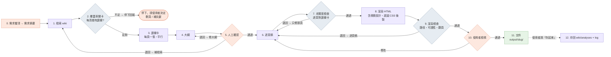

# Workflow：製作 HTML 簡報

本流程用於把 `wiki/` 的知識整理成 HTML 簡報。主題、頁數、大綱等**每次的專屬內容**不寫在這裡，而是記在 `output/<slug>/` 底下的 `brief.md` 與 `evidence/`。

## 流程圖



| 節點類型 | 顏色 | 步驟 |
|---|---|---|
| AI 節點 | 紫 | 1、3、4、6、8、12 |
| 人工確認 | 橘 | 0、5、10，以及覆蓋率不足時的停下 |
| 檢查關卡 | 灰藍 | 2、7、9 |

**原則：** 人工確認一定要等使用者明確同意；檢查關卡由 agent 執行，不通過就照退回路線處理，不可略過。

## 輸出檔案結構

```
output/<slug>/
├── brief.md          ← 需求摘要、逐頁大綱、決策紀錄
├── evidence/         ← 證據卡，一頁一張：01.md、02.md…
├── draft.md          ← 逐頁稿（步驟 6 產出，步驟 7 依此比對證據卡）
└── index.html        ← 簡報成品（單一檔案，CSS 與 JS 內嵌）
```

## 步驟

### 0. 需求釐清 → 需求摘要（人工確認）
- **一次只問一題**，用選擇題（`AskUserQuestion`）或填空題，約 6–8 題。
- 必問：使用場合與時長、聽眾熟悉程度、故事線、視覺風格（是否沿用 `assets/`）、資訊密度、HTML 功能、存放位置。
- 使用者若提供草圖或大綱，先對照 wiki 逐格檢查數字與說法是否正確，再提出修改建議。
- 以表格整理需求摘要，附初步逐頁大綱（頁次、論點、預計來源）。
- **使用者確認前不建立任何檔案。** 確認後建立 `output/<slug>/`（slug 用英數字與連字號），並把摘要寫入 `brief.md`。

### 1. 檢索 wiki（AI）
- 先讀 `wiki/index.md`，再讀相關主題頁（共識、爭議與矛盾）、論文頁、方法頁與地區頁。
- 必要時回到 `raw/papers/` 的 PDF 核對（唯讀）。
- 只用 wiki 已有的內容，不自行補充外部資料。

### 2. 覆蓋率關卡（檢查）
- 逐頁檢查：大綱裡的每一頁，是否至少有一個可追溯到論文頁（含頁碼或表號）的證據。
- **全部通過** → 進入步驟 3。
- **任何一頁不足** → **停下**，回報缺哪幾頁、缺什麼證據，請使用者決定：
  - 刪掉或合併該頁；
  - 先補文獻（匯入新論文後再回到步驟 1）；
  - 改寫論點，改成現有證據能支持的說法。
- 不可為了湊頁數而寫出沒有證據的內容。

### 3. 證據卡（AI，每頁一張、可平行）
- 每頁一張，存為 `output/<slug>/evidence/<兩位數頁碼>.md`。各頁互不相依，可以平行製作（例如分派給多個 subagent）。
- 格式：

```markdown
# 第 NN 頁：<頁面標題>

| 欄位 | 內容 |
|---|---|
| 論點 | 這頁要支持的一句話 |
| 數字與單位 | 原文數字，保留原單位 |
| 來源 | 論文 ID，頁碼／表號 |
| 情境 | 國家、樣本、研究設計 |
| 限制 | 例如：假設性問卷、類比證據、樣本不具代表性 |
| 原文依據 | 論文頁中對應的句子或段落（摘要即可，不大段引用） |
```

- 一頁有多個數字時，每個數字各列一組欄位。

### 4. 大綱（AI）
- 依證據卡整理最終大綱：每頁一個核心論點，並列出支持它的證據卡。
- 討論用簡報：從主題頁的「爭議與矛盾」挑出討論題。
- 更新 `brief.md`。

### 5. 人工確認
- 把大綱交給使用者確認。
- **退回 → 修大綱**：調整順序、合併或拆頁、改寫論點，回到步驟 4。
- **退回 → 補檢索**：需要新證據時，回到步驟 1。
- **通過** → 進入步驟 6。

### 6. 逐頁稿（AI）
- 依需求摘要的資訊密度撰寫每頁文字。
- 每頁放**來源標籤**，例如「德國｜Block2024」。
- 數字附單位；證據卡裡的「限制」要以小註呈現。
- 術語小註盡量放在頁尾。
- 最後一頁放參考文獻（APA 7，依第一作者字母排序）。

### 7. 忠實度檢查（檢查）
- 逐頁比對逐頁稿與證據卡：
  - [ ] 每個數字、單位都與證據卡一致
  - [ ] 每個論斷都能在證據卡找到依據，沒有超出證據的推論
  - [ ] 證據卡的「限制」有呈現
  - [ ] 文中引用都出現在參考文獻頁，格式符合 APA 7
- **不通過 → 只退回那一頁**修改，其他頁不動。
- 全部通過 → 進入步驟 8。

### 8. 渲染 HTML（AI，含視覺設計）
- 產出 `output/<slug>/index.html`，以相對路徑引用 `../../assets/`。
- **視覺設計**：
  - 底圖盤點：列出 `assets/template/` 的底圖，比對重複檔（例如 `bg0` 與 `底圖0`），選定要用的版本。
  - 角色配置：依需求摘要決定 `assets/icons/` 角色的用途與出現頁面。
  - 頁面配置：內容放在底圖的主要框內。
  - **底圖補白**：頁面內容太少時，可以用底圖填補空白，並以 **CSS** 後製：`filter`（`blur()`、`grayscale()`、`saturate()`、`hue-rotate()`、`brightness()`）、`opacity`、`mask-image` 漸層淡出、`mix-blend-mode`。**不修改 `assets/` 原檔，也不另存處理後的圖檔。**
- 預設功能：鍵盤 ← → 翻頁、頁碼；其他功能依需求摘要加入。
- 使用單一 HTML 檔（CSS 與 JS 內嵌），不依賴外部網路資源。

### 9. 渲染檢查（檢查）
- 用瀏覽器實際開啟檢查（內建瀏覽器的預覽以 `data:` 載入，**無法顯示本機圖片**：圖片路徑改用 PowerShell `Test-Path` 從 HTML 所在資料夾逐一驗證，圖片實際效果交給使用者在自己的瀏覽器確認）：
  - [ ] 圖片路徑正確，底圖與角色都有顯示
  - [ ] 文字疊在底圖上清楚可讀（對比足夠）
  - [ ] 每頁內容沒有溢出或被裁切
  - [ ] ← → 翻頁與頁碼正常
- **內容或版面問題 → 退回步驟 6（逐頁稿）**，修改後須重新通過步驟 7。
- 純 CSS 參數問題（濾鏡強度、透明度、間距）可以直接在步驟 8 修正，再重新檢查。

### 10. 使用者檢視（人工確認）
- 回報兩項檢查的結果與成品位置，請使用者檢視。
- **修改** → 回到步驟 6。
- **通過** → 交件。

### 11. 交件
- 確認 `output/<slug>/` 內有 `brief.md`、`evidence/`、`index.html`。
- 在 `wiki/log.md` 追加一筆 `slides` 紀錄：主題、頁數、使用的論文、檢查結果。

### 12. 存回 wiki（使用者說「存起來」時）
- **只有在使用者說「存起來」時**才執行（依 `AGENTS.md` §7.2）。
- 把簡報大綱存成 `wiki/analyses/<YYYY-MM-DD>-<slug>.md`，連結到 `output/<slug>/index.html`。
- 更新 `wiki/index.md`，並在 `wiki/log.md` 追加 `save` 紀錄。
